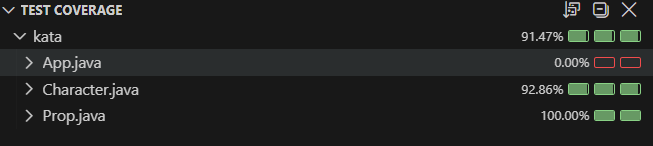

# Kata RPG Combat - Java TDD

**Repositorio:** https://github.com/AndreaVaGo/kata-java-tdd-RPG-Combat

## Descripción

Kata de TDD (Test-Driven Development) que consiste en implementar las reglas de combate de un juego de rol (RPG) siguiendo el ciclo Red-Green: escribir primero un test que falla, y después el código mínimo para que pase.

El dominio del juego incluye personajes que pueden dañarse y curarse entre sí, con reglas de nivel, alcance, facciones/alianzas, y objetos del entorno (accesorios) que también pueden ser dañados.

## Tecnologías

- Java 21
- Maven
- JUnit 5 (5.12.0)
- Hamcrest 2.2
- JaCoCo (cobertura de tests)

## Estructura del proyecto

- `Character.java` — clase principal del personaje: salud, nivel, vida, alcance, facciones, y toda la lógica de combate (daño, curación).
- `Damageable.java` — interfaz que define el contrato mínimo para poder recibir daño (`getHealth`, `setHealth`, `setAlive`). La implementan tanto `Character` como `Prop`.
- `Prop.java` — clase para objetos del entorno (accesorios) que pueden ser dañados y destruidos, pero no atacan ni se curan.

## Iteraciones implementadas

### Iteración 1 — Reglas básicas
- Los personajes nacen con 1000 de salud, nivel 1 y vivos.
- Pueden infligir daño a otros personajes (la salud nunca baja de 0; al llegar a 0 el personaje muere).
- Pueden curar a otros personajes (no se puede curar a un personaje muerto, ni superar el máximo de 1000 de salud).

### Iteración 2 — Restricciones de daño/curación y nivel
- Un personaje no puede dañarse a sí mismo.
- Un personaje solo puede curarse a sí mismo (o a un aliado, ver iteración 4).
- Si el objetivo tiene 5 o más niveles por encima del atacante, el daño se reduce un 50%.
- Si el objetivo tiene 5 o más niveles por debajo del atacante, el daño aumenta un 50%.

### Iteración 3 — Alcance de ataque
- Cada personaje tiene un alcance máximo (por defecto 2 metros, cuerpo a cuerpo; configurable a 20 metros para combate a distancia).
- Solo se puede infligir daño si la distancia al objetivo está dentro del alcance.

### Iteración 4 — Facciones y aliados
- Los personajes pueden unirse o abandonar una o más facciones (al crearse, no pertenecen a ninguna).
- Dos personajes que comparten al menos una facción se consideran aliados.
- Los aliados no pueden dañarse entre sí.
- Los aliados sí pueden curarse mutuamente.

### Iteración 5 — Objetos del entorno (accesorios)
- Los personajes pueden dañar objetos que no son personajes (por ejemplo, un árbol), a través de la clase `Prop`.
- Los accesorios no se pueden curar ni causan daño, y son neutrales (no pertenecen a ninguna facción).
- Cuando la salud de un accesorio llega a 0, se destruye.

## Decisiones de diseño

- **Interfaz `Damageable` en vez de herencia**: `Character` y `Prop` no son el mismo tipo de "cosa" (uno lucha y cura, el otro no), pero ambos comparten la capacidad de recibir daño y tener salud. Por eso se modela como una interfaz (relación "puede hacer") en vez de herencia (relación "es un").
- **Método `dealDamageToProp` separado de `dealDamage`**: por simplicidad, en vez de generalizar `dealDamage` para aceptar cualquier `Damageable` (lo que requeriría comprobaciones de tipo más avanzadas), se optó por un método específico para dañar accesorios, con una lógica más simple (sin niveles, sin alianzas, sin distancia).
- **Métodos privados `calculateDamage` y `applyDamage`**: se extrajeron de `dealDamage` para separar responsabilidades (cálculo del daño según nivel, y aplicación del daño a la salud), siguiendo el principio de responsabilidad única (SRP).

## Cómo ejecutar los tests

```bash
mvn test
```

Esto ejecuta los 20 tests del proyecto y genera el informe de cobertura con JaCoCo.

## Cobertura de tests



## Autora

Andrea
